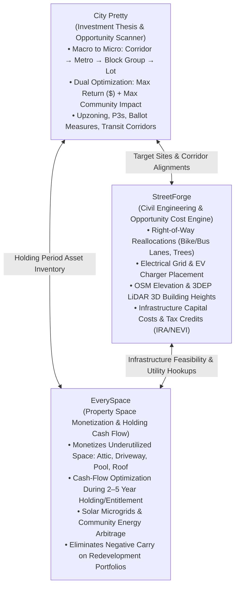
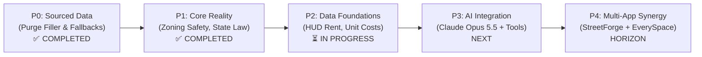

# City Pretty Ecosystem: Grand Vision & Technical Architecture

> **Correction, 16 Nov 2026:** the vision below stands, but this document's status claims and vendor prices were not
> checked. Phases marked "✅ COMPLETED" were not complete, the paid-data prices were not from the vendors, and the
> EverySpace income ranges had no source. For the current plan, real status and vendor prices checked on the vendors'
> own pages, see [`GAME-PLAN.md`](GAME-PLAN.md). For data status, see [`DATA-AUDIT-AND-TRANSPARENCY.md`](DATA-AUDIT-AND-TRANSPARENCY.md).

**Platform Vision:** The definitive real-world intelligence engine for real estate investors and civic builders who acquire land, build housing, and transform communities while generating high-conviction financial returns.

---

## 1. The Core Ecosystem: Three Interconnected Platforms

City Pretty does not operate in isolation. It forms the macro-to-micro intelligence core of a tripartite software ecosystem:

---

## 2. Capital Deployment Across Scales: From $100K to $100M+

The AI advisor is engineered to operate across the full spectrum of capital deployment, delivering specific, actionable guidance on **what to build, where to buy, when to execute, and why**:

### Tier 1: Micro-Investor & Individual Homeowner ($50,000 – $500,000)
- **Goal:** Buy a single house or optimize an existing property for maximum appreciation and monthly cash flow.
- **Capabilities:**
  - **By-Right Middle Housing:** Evaluates state preemption statutes (CA SB 9/684, TX SB 15, WA HB 1110, FL Live Local) to calculate whether a parcel can add an ADU, Junior ADU, or be split into multiple fee-simple parcels.
  - **Renovation Quote Evaluator:** The homeowner uploads contractor quotes, photos, or architectural plans. The engine benchmarks unit costs against local DOT and RSMeans data, calculating whether the proposed expenditure adds positive equity or represents over-capitalization.
  - **EverySpace Cash Flow:** Identifies immediate revenue opportunities (leasing the driveway, pool, storage attic, or rooftop solar PPA) to offset mortgage payments before or during renovations.

### Tier 2: Neighborhood Builder & Community Syndicator ($1,000,000 – $10,000,000)
- **Goal:** Assemble 5 to 20 parcels in an upzoning corridor, developing missing-middle housing while capturing infrastructure-driven appreciation.
- **Capabilities:**
  - **Underused Land Screening:** Scans vacant lots, excess surface parking, and underperforming commercial strips within walksheds of high-frequency transit.
  - **Sub-Additive Value Stacking:** Models the joint equity lift of coordinated improvements (mature street trees + traffic calming + facade rehab) using diminishing-returns saturation curves.
  - **Holding Period Optimization (EverySpace):** Keeps existing residential or commercial units cash-flowing through short-term space rentals during the 12–24 month design, zoning verification, and permitting phases.

### Tier 3: City Transformer & Infrastructure Fund ($20,000,000 – $100,000,000+)
- **Goal:** Large-scale community transformation and transit-oriented corridor development.
- **Capabilities:**
  - **Intercity & Regional Rail Corridors (e.g., Phoenix–Tucson, Austin–San Antonio):**
    - Identifies optimal station locations based on land acquisition costs, existing parcel ownership (public surplus vs. private assembly), zoning preemption, and population growth.
    - Determines optimal facility placement: e.g. whether a stop belongs in an urban core, a suburban park-and-ride, or an industrial railyard for maintenance operations.
    - Directs strategic perimeter land acquisition: guides the fund to acquire single-family homes and vacant parcels within a 10-minute walkshed before station ground-breaking.
  - **Public-Private Partnerships (P3) & Municipal Finance:**
    - Models Tax Increment Financing (TIF), California EIFD, Texas TIRZ, and Florida CRA bonding capacity to fund public infrastructure (bike networks, streetscapes, stormwater utilities).
    - **Civic Campaign Feasibility:** Flags local ballot measures in drafting stages and estimates the public campaign investment needed to unlock statutory upzoning and infrastructure bonds.

---

## 3. Sister Application Architectures

### A. StreetForge: Civil Engineering & Opportunity Cost Engine
StreetForge translates high-level planning suggestions into buildable civil engineering specifications:
1. **Right-of-Way Reallocation:** Analyzes curb-to-curb street geometry (via OpenStreetMap road tags and LiDAR elevation profiles). When a user recommends removing a travel lane for a protected bike lane or BRT lane:
   - Calculates traffic throughput changes, pedestrian crash reduction (via KABCO crash factors), and air quality improvements.
   - Calculates full capital expenditure (pavement cold-planing, thermoplastic striping, concrete barrier curbs, drainage adjustments).
2. **Electrical Grid & EV Infrastructure Placement:**
   - Evaluates utility easements, distribution line proximity, and transformer capacity to identify the lowest-cost parking lots for DC Fast Charging stations.
   - Integrates federal NEVI (National Electric Vehicle Infrastructure) formula grants and IRA § 30C commercial alternative fuel vehicle refueling property tax credits.
3. **OpenStreetMap 3D & Elevation Integration:**
   - Ingests USGS 3DEP LiDAR (1-meter DEM) and OSM building footprint tags (`height`, `building:levels`, `roof:shape`) to calculate terrain slope, cut-and-fill requirements, and viewshed preservation.

### B. EverySpace: Asset Monetization & Anti-Negative Carry Engine
EverySpace solves the single largest hazard in urban real estate development: **holding cost drag during entitlement and permitting delays**:
1. **Granular Space Breakdown per Property:**
   - Driveway / RV / Boat parking ($150–$350/mo)
   - Attic / Basement storage ($100–$250/mo)
   - Swimming pool / yard event rental ($30–$80/hr via Swimply-style models)
   - Rooftop solar microgrid lease / community solar PPA ($120–$250/mo net utility credit)
2. **Reinvestment Flywheel:** Properties generate income from day one of acquisition. Generated revenue covers debt service, funding subsequent community improvements or building contingency reserves.

---

## 4. Comprehensive Data Sources Matrix: Free vs. Paid

To achieve true real-world accuracy without hallucinating data, City Pretty integrates data in tiers:

### Free & Open Public Data (Zero License Cost)

| Source Name | API / Feed Type | Data Acquired | Core Benefit to City Pretty |
| :--- | :--- | :--- | :--- |
| **OpenStreetMap & Overpass API** | REST / Overpass QL | Road geometries, street widths, sidewalk tags, building footprints, amenities | Enables exact street geometry, elevation slope, and walkability network routing without per-tile fees. |
| **USGS 3DEP LiDAR** | AWS S3 Public Bucket / Cloud-Optimized GeoTIFF | 1-meter digital elevation models (DEM), point clouds | Measures exact rooftop tilt, ground elevation, building heights, and flood plane elevations. |
| **U.S. Census Bureau (TIGER + ACS)** | Census Data API | Block group boundaries, median rent, household income, tenure (renter vs owner), commute modes | Core demographic and socio-economic baseline for all 639+ US counties. |
| **HUD Fair Market Rents (SAFMR)** | HUD User REST API | ZIP code-level 40th and 50th percentile rent by bedroom count (0–4 BR) | Empirical baseline for rental pro-formas and EverySpace holding income without unverified rent heuristics. |
| **State DOT Bid Tabs** | State DOT Contracts Portals (TxDOT, FDOT, Caltrans, etc.) | Awarded unit bid prices for concrete, curb ramps, street lighting, sound walls | Replaces assumed construction multipliers with legally binding contractor awards. |
| **MobilityData & National Transit Database (NTD)** | GTFS Zip Feeds & FTA NTD API | Transit route alignments, stop locations, headway frequencies, ridership | Measures exact distance from any parcel to high-frequency transit for statutory exemptions (CA AB 2097). |
| **EPA Smart Location Database** | ArcGIS REST Service | National Walkability Index, regional employment accessibility, transit connectivity | Standardized federal walkability scoring for block groups. |
| **FEMA National Flood Hazard Layer (NFHL)** | FEMA GeoPlatform REST | 100-year and 500-year flood hazard zones, floodways | Deterministic statutory exclusion for lot splits and housing densification. |
| **OpenAddresses & County GIS Portals** | ESRI FeatureServer / GeoJSON | Deeded parcel polygons, APNs, situs addresses, tax roll base years | Free public property boundaries across 639+ counties. |

### Paid & Commercial Data Sources (High Value for Future Integration)

| Source Name | Estimated Cost | Core Capabilities | Strategic Deployment Point |
| :--- | :--- | :--- | :--- |
| **Regrid (Loveland Technologies)** | $500 – $2,000 / mo | Standardized nationwide parcel boundaries, ownership names, land use codes across 3,200 counties (157M parcels). | Replaces fragmented county GIS REST endpoints with one standardized API. Deploy when scaling past 1,000 counties. |
| **ATTOM Data Solutions** | $1,500 – $4,000 / mo | Live recorder deed transfers, arm's-length transaction flags, mortgage loan amounts, foreclosure distress status. | Powers the valuation back-testing engine and flags undervalued off-market acquisition opportunities. |
| **CoStar / LoopNet** | $20,000 – $50,000 / yr | Commercial lease comps, vacancy rates, net absorption, industrial and retail market rents. | Essential for commercial-to-residential conversions (TX SB 840, FL Live Local) and large retail redevelopments. |
| **RSMeans Data (Gordian)** | $3,500 – $10,000 / yr | Construction cost databases localized to 3-digit ZIP codes with labor/equipment/material splits. | Powers the homeowner renovation quote evaluator and StreetForge civil cost estimates. |
| **Shovels.ai / BuildingPermits.com** | $1,000 – $3,000 / mo | Real-time municipal building permit filings, contractor performance histories, renovation velocity. | Tracks neighborhood capital investment in real time, detecting gentrification or revitalization 12 months ahead of sales comps. |
| **LightBox / LandVision** | $10,000 – $25,000 / yr | Comprehensive zoning overlay polygons, environmental brownfields, utility easements, wetland boundaries. | Due diligence screening for $10M+ institutional land assembly. |

---

## 5. Phased Implementation Roadmap

1. **Phase 1: Grounding & Clean Foundation (Current)**
   - Complete P1 and P2 items: integrate HUD Small Area Fair Market Rents (SAFMR), wire public agency bid item costs, and back-test valuation estimates against actual sales.
   - Maintain 100% test pass rate (`npm run check`) with zero hallucinated figures.
2. **Phase 2: AI Advisor Connection & Tool Execution**
   - Connect Claude 3.5 Sonnet / Opus 5.5 in `workers/api-proxy.ts` with prompt caching.
   - Equip the AI with structured lookup tools: `lookupParcelFacts()`, `checkStatutoryZoning()`, `getFundingPrograms()`, `getConstructionCosts()`, and `getHudRents()`.
3. **Phase 3: StreetForge & EverySpace Synergy**
   - Ingest OpenStreetMap elevation and building heights to generate StreetForge opportunity cost ledgers.
   - Add EverySpace asset holding pro-formas to single-parcel and neighborhood prospectus exports.
4. **Phase 4: Fund-Scale Corridor Assembly**
   - Implement intercity corridor screening (Phoenix–Tucson, Austin–San Antonio, Pacific Northwest HSR) with station walkshed parcel assembly algorithms and municipal P3 bonding matrices.
